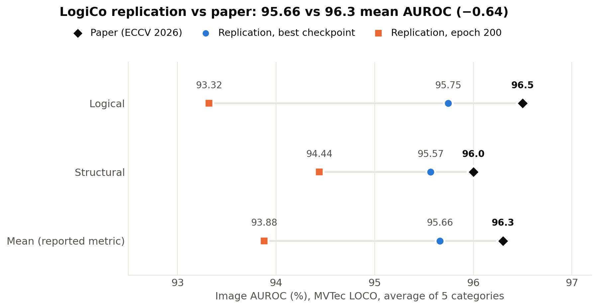
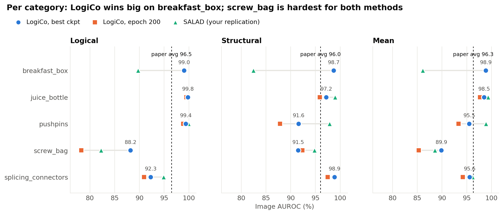
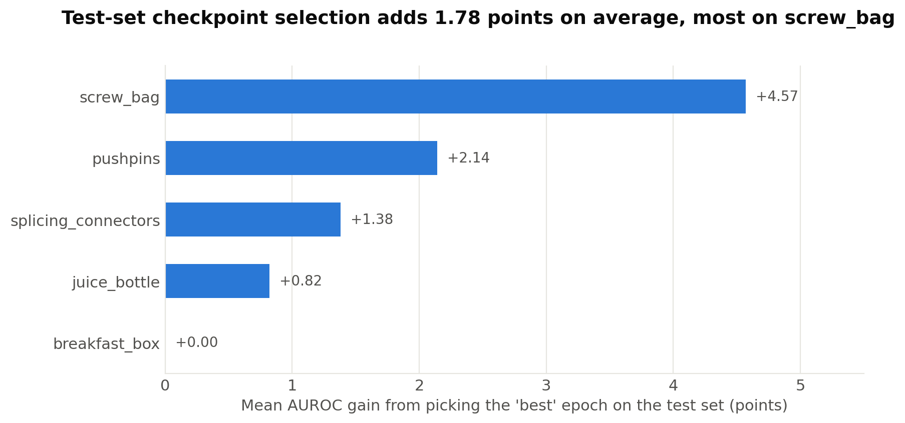
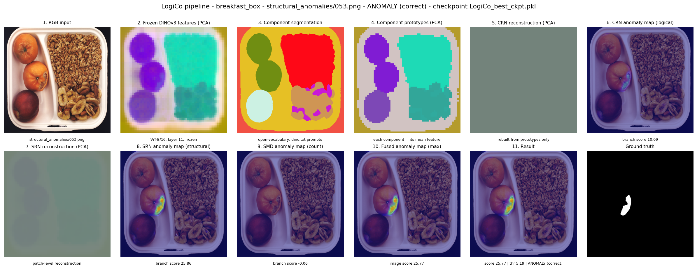
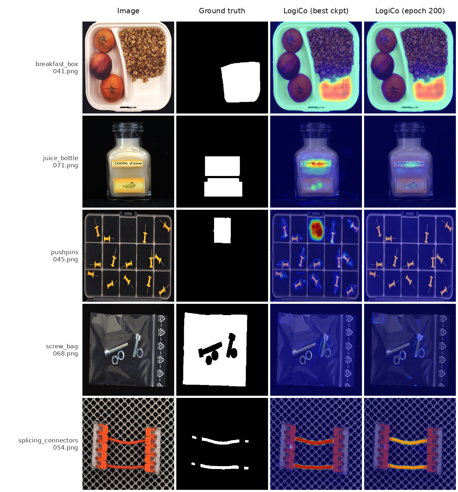
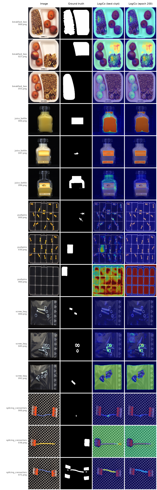
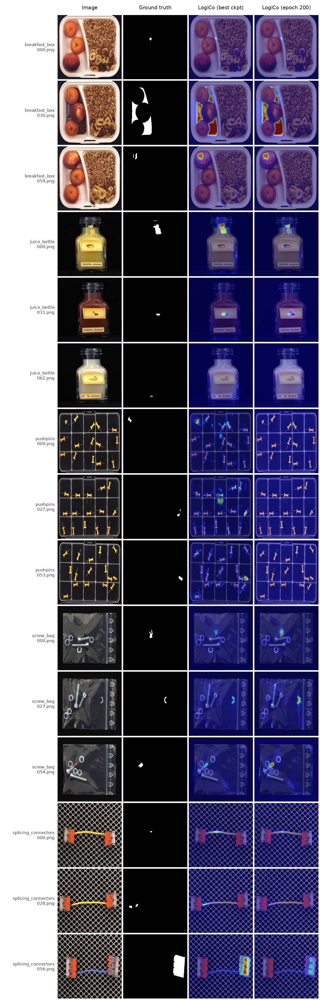

# LogiCo replication on MVTec LOCO

Independent replication of **LogiCo** (Zhang, Xu, Zhou; ECCV 2026; arXiv 2606.28688) for logical and structural
anomaly detection, run on one NVIDIA A10G (24 GB) on AWS (RMIT RACE Workbench).

- Paper: arXiv 2606.28688
- Official code: https://github.com/cnulab/LogiCo (replicated at commit `ac724ffb0c36392b443eecc41b58ba152b4298a0`)
- This repository contains **only my scripts, patch, logs-derived results and notes**. It does not contain the
  authors' code, the dataset, DINOv3 weights or trained checkpoints.

## Result (MVTec LOCO, 5 categories, image-level AUROC, mean of logical and structural)

| | Logical | Structural | **Mean** |
|---|---|---|---|
| Paper | 96.5 | 96.0 | **96.3** |
| Replication, best checkpoint | 95.75 | 95.57 | **95.66** |
| Replication, final epoch 200 | 93.32 | 94.44 | **93.88** |

The best checkpoint was selected on the test set, as the official evaluation script does. The epoch-200 column is the
checkpoint-selection-free number. Details and per-category results: `05_results/`.

## Folder guide

| Folder | Contents |
|---|---|
| `01_methodology/` | How LogiCo works, plus a pipeline diagram |
| `02_src/` | How to get the authors' code at the exact commit I used |
| `03_scripts/` | Gradient-accumulation patch, run script, chart and visualisation scripts |
| `04_configs/` | Training settings used |
| `05_results/` | Comparison CSV, results table, figures, per-image score CSVs |
| `06_environment/` | Requirements and AWS setup notes |
| `07_replication_notes/` | Deviations from the paper and the problems I hit |

## Results & Visualisations

### Performance Figures

  
  
  

### Qualitative Anomaly Detection

  

  
  
  

## How to reproduce (short version)

1. Follow `06_environment/environment_setup.md`.
2. Clone the authors' code as described in `02_src/README.md` and apply `03_scripts/accum.patch`.
3. Run `bash 03_scripts/run_all_categories.sh` from the cloned repo.
4. Make figures with the scripts in `03_scripts/`.

## Licence and credit

My files are Apache-2.0 (see `LICENSE`), matching the authors' code. All credit for the method goes to the LogiCo
authors. MVTec LOCO is licensed by MVTec and must be downloaded from its official site.
